# Fireball Tool tables and fixtures in SolidCraft

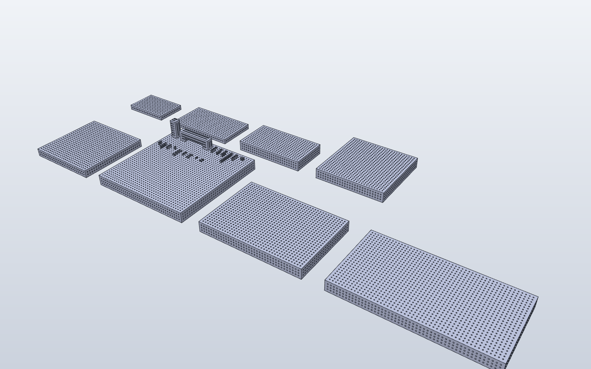

Every model on Fireball Tool's public CAD page (https://www.fireballtool.com/apps/cad/models), 25 STEP files, placed in one SolidCraft 0.45 design (`Fireball Tool tables and fixtures.sc`, 17 MB). Opens in the free, open-source SolidCraft (https://solidcraft.io/).

- **Layout:** the 8 tables stand in two rows, smallest first. The 17 fixture blocks sit on top of the 78 x 78 table, as they would on a real table.
- **Placement:** each model is its own component, named by part number, standing on z = 0 with Y-up turned to Z-up. The STEP files are unchanged, and each sits at the size Fireball states.
- **Use in CAM:** the same STEP files import into CamCraft (https://github.com/NeoTech/Camcraft) as fixtures, at the right size.

| Picture | Part | Size mm (X x Y x Z) | Product page |
|---|---|---|---|
| 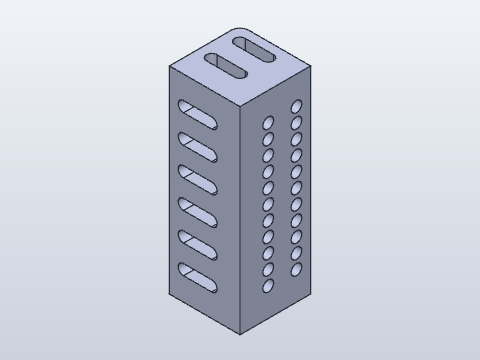 | FA75-CTB144 | 127 x 127 x 356 | https://www.fireballtool.com/products/14-cast-iron-tower-block |
| 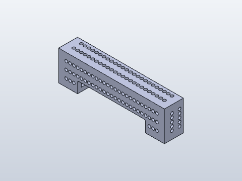 | FA75-CTB2858 | 711 x 127 x 203 | https://www.fireballtool.com/products/cast-tower-block-20x5x8-black-oxide |
| 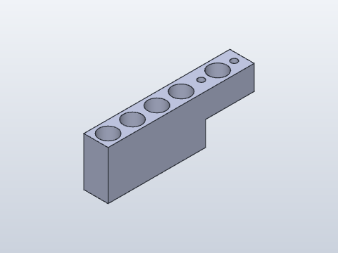 | FA75-MBH612 | 25 x 152 x 51 | https://www.fireballtool.com/products/fence-pin-blocks-6x1x2 |
| 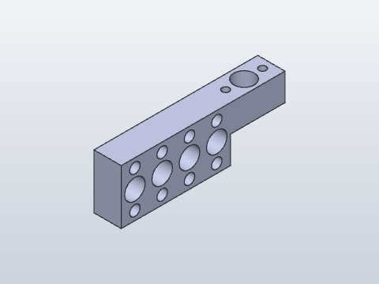 | FA75-MBH641 | 25 x 152 x 51 | https://www.fireballtool.com/products/twist-block-4x1-pattern-3-4-system |
| 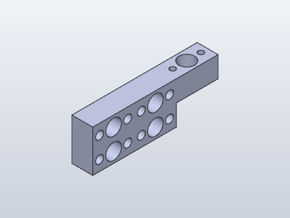 | FA75-MBH644 | 25 x 152 x 51 | https://www.fireballtool.com/products/twist-block-2x2-pattern-3-4-system-1 |
| 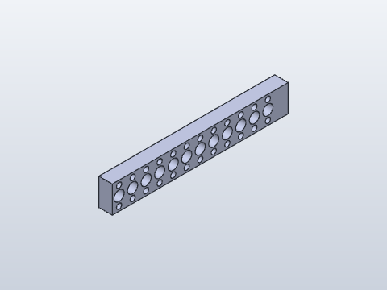 | FA75-MBV130 | 25 x 330 x 51 | https://www.fireballtool.com/products/extension-block-13 |
| 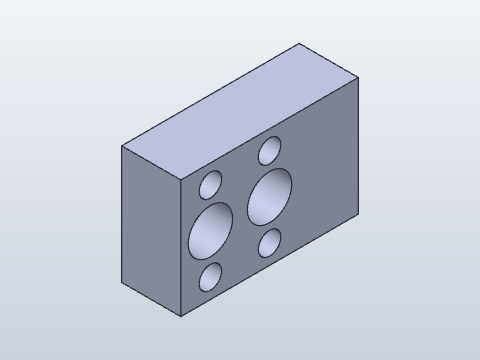 | FA75-MBV302 | 25 x 76 x 51 | https://www.fireballtool.com/products/ext-block-3-3-4-system-1 |
| 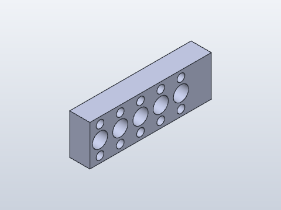 | FA75-MBV605 | 25 x 152 x 51 | https://www.fireballtool.com/products/extension-block-6 |
| 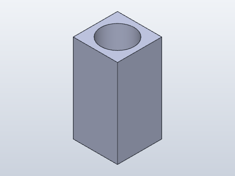 | FA75-SBS120 | 25 x 25 x 51 | https://www.fireballtool.com/products/post-pin-1-x-2 |
| 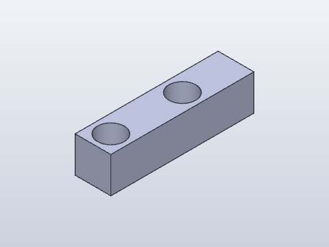 | FA75-SBS410 | 25 x 102 x 25 | https://www.fireballtool.com/products/fence-pin-blocks-4x1x1 |
| 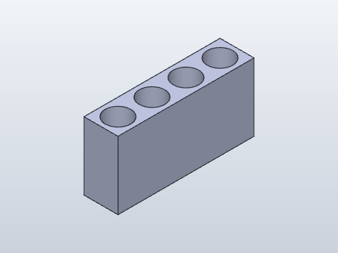 | FA75-SBS420 | 25 x 102 x 51 | https://www.fireballtool.com/products/fence-pin-blocks-4x1x2 |
| 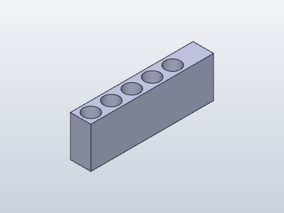 | FA75-SBS620 | 25 x 152 x 51 | https://www.fireballtool.com/products/fence-pin-blocks-6x1x2 |
| 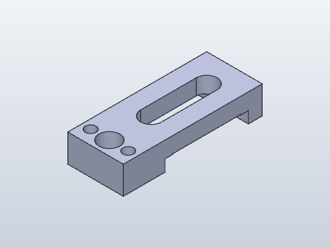 | FA75-TBM521 | 51 x 127 x 25 | https://www.fireballtool.com/products/tooth-block-5-mini-3-4-system |
| 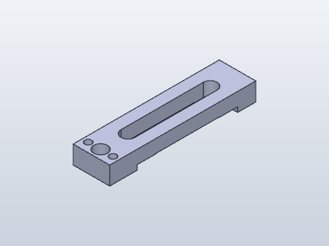 | FA75-TBM821 | 51 x 203 x 25 | https://www.fireballtool.com/products/tooth-block-kit |
| 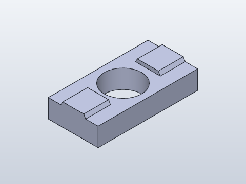 | FA75-TBW102-8 | 25 x 51 x 11 | https://www.fireballtool.com/products/tooth-block-5-mini-3-4-system |
| 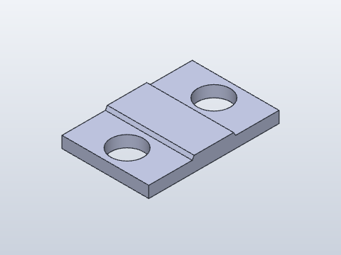 | FA75-TBW302-8 | 51 x 76 x 9 | https://www.fireballtool.com/products/tooth-block-kit |
| 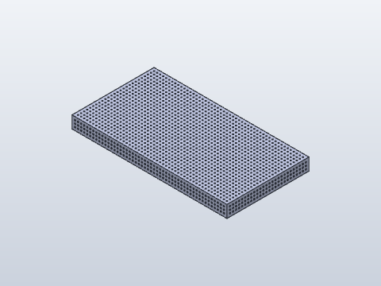 | FA75-TCG102 | 2591 x 1372 x 203 | https://www.fireballtool.com/products/super-heavy-duty-tabletop-4-5-x-8-5-102-x-54 |
| 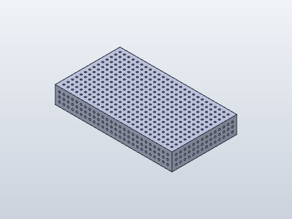 | FA75-TCG5430 | 1372 x 762 x 203 | https://www.fireballtool.com/products/welding-table-4-5-x-2-5-54-x-30 |
| 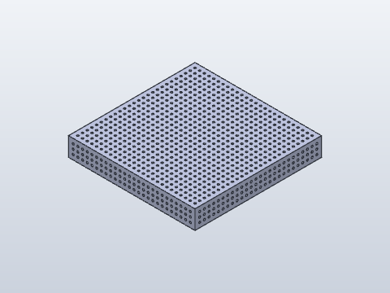 | FA75-TCG5454 | 1372 x 1372 x 203 | https://www.fireballtool.com/products/welding-table-4-5-x-4-5-54-x-54 |
| 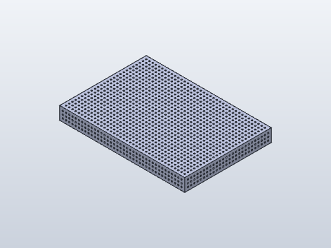 | FA75-TCG7854 | 1981 x 1372 x 203 | https://www.fireballtool.com/products/fireball-tool-welding-table-78-x-54 |
| 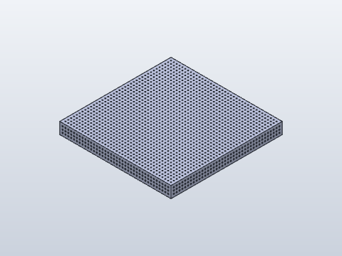 | FA75-TCG7878 | 1981 x 1981 x 203 | https://www.fireballtool.com/products/welding-table-6-5-x-6-5-78-x-78 |
| 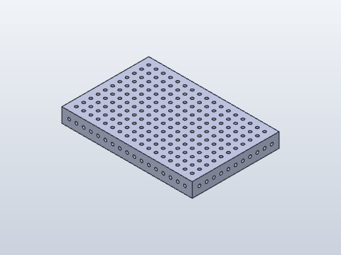 | FA75-TCH3624 | 914 x 610 x 102 | https://www.fireballtool.com/products/dragon-wagon-36-x-24 |
| 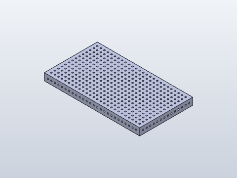 | FA75-TCH5430 | 1372 x 762 x 102 | https://www.fireballtool.com/products/dragon-wagon-54-x-30 |
| 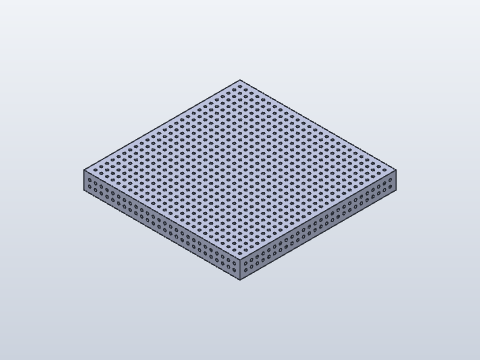 | FA75-TCH5454 | 1372 x 1372 x 152 | https://www.fireballtool.com/products/dragon-wagon-54-x-54-standard-duty |
| 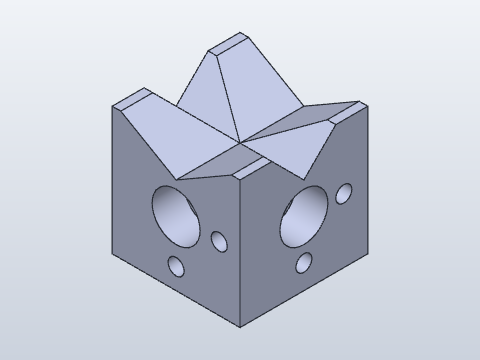 | FA75-VBK100 | 51 x 51 x 51 | https://www.fireballtool.com/products/2-x-2-vee-block-ebr |

## Rebuild it yourself

1. `python3 -I fixtures/vendor-fetch/fetch.py fireball`, which downloads the STEP files from fireballtool.com into `downloads/fireball/`.
2. `solidcraft-cli run samples/fireball/build-script.json --save fireball.sc`. Run it from the repo root: paths in the script are relative to it.

The models are Fireball Tool's own CAD and are shown here as a sample for Fireball Tool. Fireball Tool owns all rights to them.
