# Saunders Machine Works fixture plates and workholding in SolidCraft

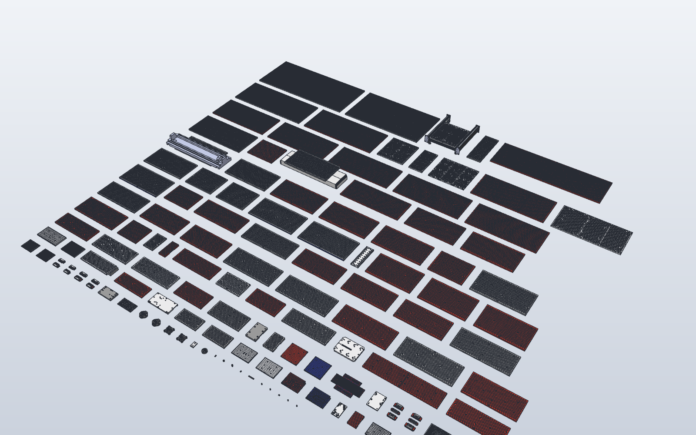

> An independent sample, not made or endorsed by Saunders Machine Works. The models are Saunders Machine Works' own CAD, shown as a sample for Saunders, which owns all rights to them.

All 122 STEP solid models linked from the product pages at https://saundersmachineworks.com, placed in one SolidCraft 0.45 design: `Saunders Machine Works fixture plates and workholding.sc`, 55 MB. It opens in the free, open-source SolidCraft (https://solidcraft.io/).

- **Layout:** the parts sit in rows on z = 0, largest first. Each model is its own component, named after its file.
- **Orientation:** plates and pallets are turned to lie flat. Vises, pucks, pins and jaws keep their file's orientation.
- **Unchanged files:** the STEP files are not modified. Some hold more than one variant (e.g. the Carvera plate has both its 1/4" and M6 versions), and those variants overlap as they do in the file.
- **Use in CAM:** the same STEP files import into CamCraft (https://github.com/NeoTech/Camcraft) as fixtures.

## Rebuild it

1. `python3 -I fixtures/vendor-fetch/fetch.py saunders`, which downloads from saundersmachineworks.com into `downloads/saunders/`.
2. `solidcraft-cli run samples/saunders/build-script.json --save saunders.sc`, run from the repo root. It takes about 9 minutes on a 16-core machine.

## Parts

| Picture | Model | Size mm (X x Y x Z, as placed) | Product page |
|---|---|---|---|
| 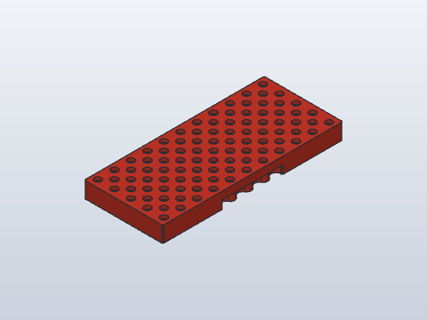 | 14x6_96mm_Pallet_Solid_Model | 346 x 151 x 30 | https://saundersmachineworks.com/products/smw-96mm-pallet |
| 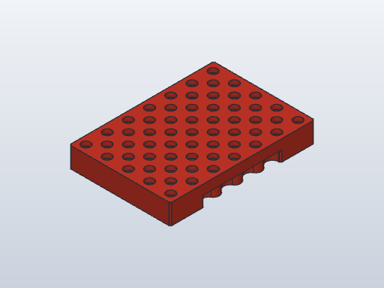 | 8x6_96mm_Pallet_Solid_Model | 216 x 151 x 30 | https://saundersmachineworks.com/products/smw-96mm-pallet |
| 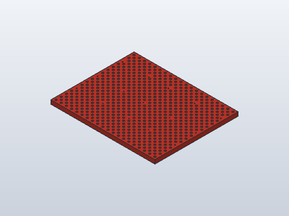 | AVID_2436_25x40 | 635 x 508 x 23 | https://saundersmachineworks.com/products/avid-benchtop-pro-2-x-3-aluminum-fixture-tooling-plates |
| 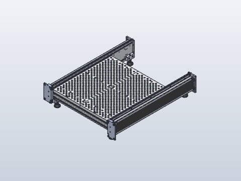 | AVID_Benchtop-2x2_26x12 | 945 x 809 x 210 | https://saundersmachineworks.com/products/avid-benchtop-pro-2-x-2-aluminum-fixture-tooling-plates |
| 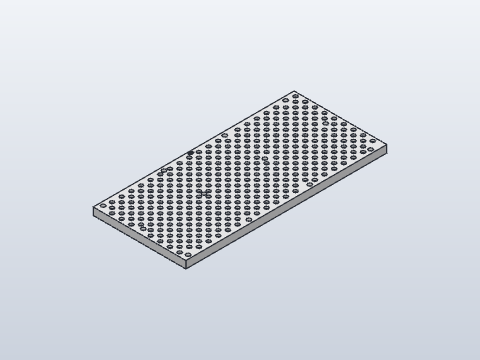 | AVID_PRO4824_26x12 | 660 x 305 x 24 | https://saundersmachineworks.com/products/avid-benchtop-pro-2-x-4-aluminum-fixture-tooling-plates |
| 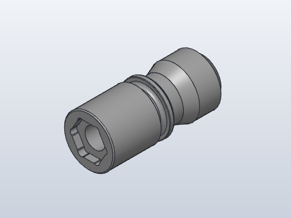 | Adapter_Pin_Locating | 29 x 13 x 13 | https://saundersmachineworks.com/products/smw-thread-adapter-pin |
| 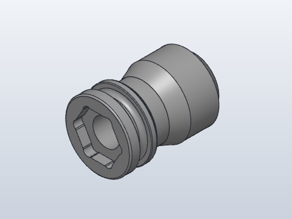 | Adapter_Pin_Non-locating | 19 x 13 x 13 | https://saundersmachineworks.com/products/smw-thread-adapter-pin |
| 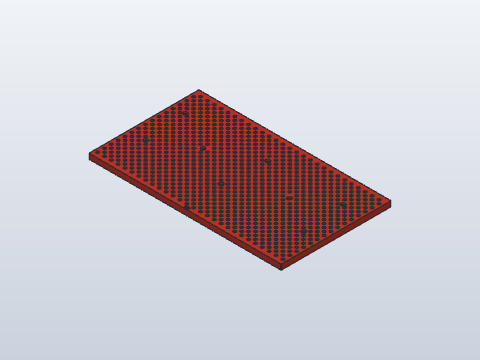 | Brother_S700_Fixture_Plate | 889 x 508 x 24 | https://saundersmachineworks.com/products/brother-speedio-s700x1-steel-fixture-tooling-plate |
| 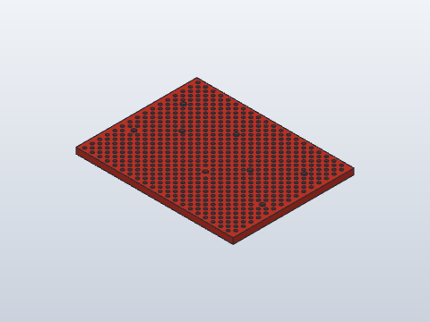 | Brother_Speedio_S500_Fixture_Plate | 660 x 508 x 24 | https://saundersmachineworks.com/products/brother-speedio-s500-fixture-tooling-plate |
| 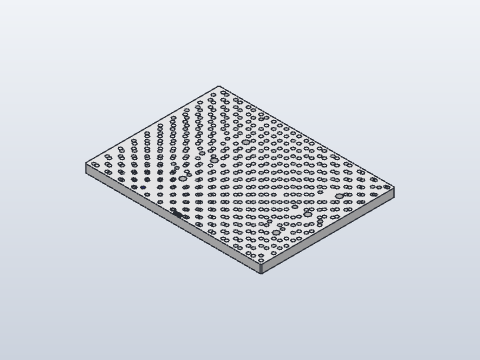 | Carbide3D_Nomad_10.44x8 | 265 x 202 x 12 | https://saundersmachineworks.com/products/carbide3d-nomad-fixture-tooling-plate |
| 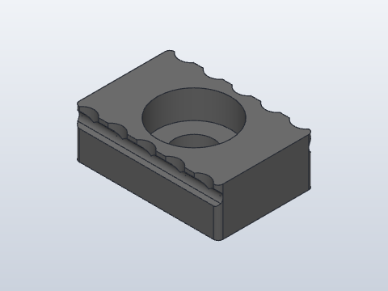 | Castle_Grip | 19 x 13 x 6 | https://saundersmachineworks.com/products/basic-fixture-plate-starter-kit |
| 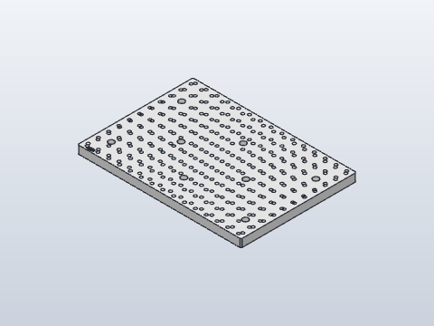 | DMC2_Mini_CAD_Master | 302 x 213 x 15 | https://saundersmachineworks.com/products/shariff-dmc2-mini-fixture-tooling-plate |
| 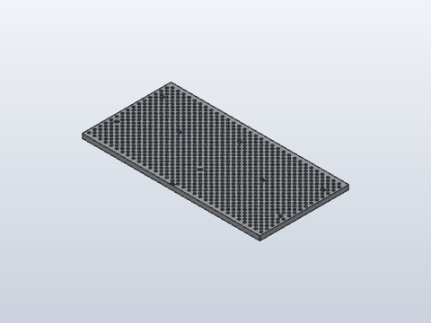 | Doosan_DNM4500_40x16 | 1016 x 508 x 24 | https://saundersmachineworks.com/products/doosan-dnm-4500-fixture-tooling-plate |
| 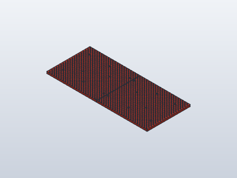 | Doosan_DNM_5700_Rev2 | 1416 x 610 x 24 | https://saundersmachineworks.com/products/doosan-dnm-5700-fixture-tooling-plate |
|  | Doosan_DNM_6700_Fixture_Plate_Set | 1699 x 711 x 24 | https://saundersmachineworks.com/products/doosan-dnm-6700-fixture-tooling-plate-set |
|  | FADAL_VMC-3016_40x20 | 1016 x 406 x 22 | https://saundersmachineworks.com/products/fadal-vmc-3016-steel-tooling-plate |
| 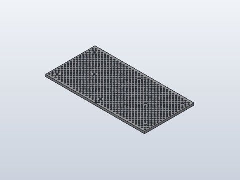 | FADAL_VMC-4020_40x20 | 1016 x 508 x 20 | https://saundersmachineworks.com/products/fadal-vmc-4020-steel-fixture-tooling-plate |
|  | FADAL_VMC15_Fixture_Plate | 889 x 406 x 24 | https://saundersmachineworks.com/products/fadal-vmc15-steel-tooling-plate |
| 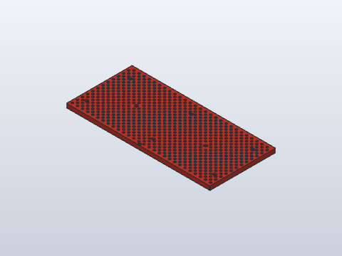 | FANUC_Long_Bed_Fixture_Plate | 889 x 406 x 24 | https://saundersmachineworks.com/products/robodrill-long-bed-fixture-tooling-plate |
| 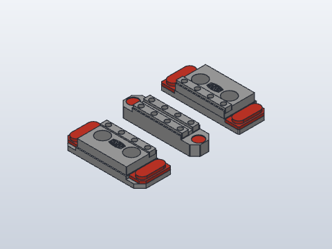 | Gen3_Dual_Station_INCH | 253 x 152 x 35 | https://saundersmachineworks.com/products/modular-vise-gen3 |
| 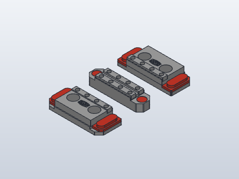 | Gen3_Dual_Station_Mod_Vise_M12 | 253 x 145 x 35 | https://saundersmachineworks.com/products/modular-vise-gen3 |
| 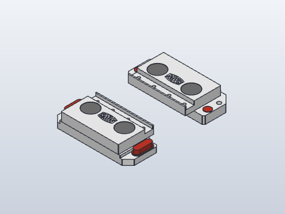 | Gen3_Hobby_Mod_Vise_Inch | 176 x 128 x 27 | https://saundersmachineworks.com/products/modular-vise-system-hobby-gen3 |
| 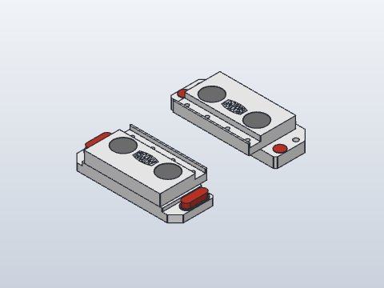 | Gen3_Hobby_Mod_Vise_Metric | 176 x 134 x 27 | https://saundersmachineworks.com/products/modular-vise-system-hobby-gen3 |
| 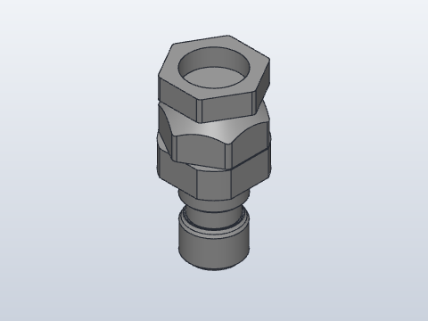 | Gen3_PlugJack_Share_Model | 41 x 20 x 20 | https://saundersmachineworks.com/products/plugjack |
| 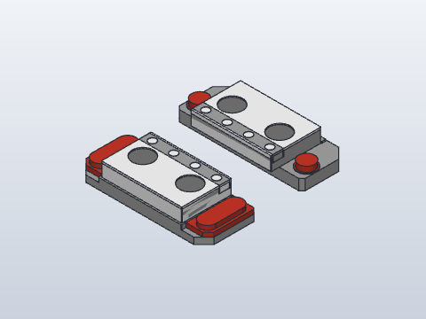 | Gen3_Single_Station_Mod_Vise_1-2in | 174 x 152 x 35 | https://saundersmachineworks.com/products/modular-vise-gen3 |
| 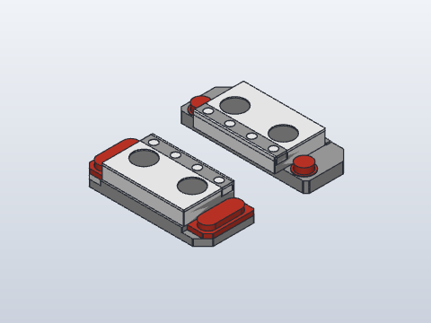 | Gen3_Single_Station_Mod_Vise_M12 | 174 x 150 x 35 | https://saundersmachineworks.com/products/modular-vise-gen3 |
| 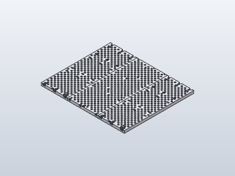 | HDM_Set_Rev2 | 790 x 660 x 23 | https://saundersmachineworks.com/products/shapeoko-hdm-1-2-fixture-tooling-plate |
| 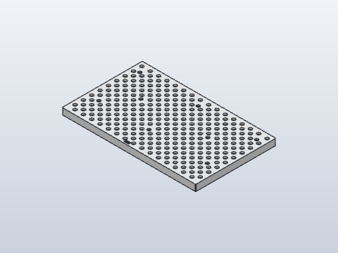 | Haas_CM-1_20x12 | 508 x 305 x 24 | https://saundersmachineworks.com/products/haas-cm-1-tooling-plate |
| 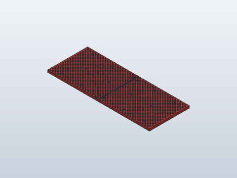 | Haas_DC-2_Fixture_Plate_Set | 1295 x 508 x 24 | https://saundersmachineworks.com/products/haas-dc-2-fixture-tooling-plate |
|  | Haas_DM-2_40x16 | 1016 x 406 x 20 | https://saundersmachineworks.com/products/dm-2-tooling-plate |
| 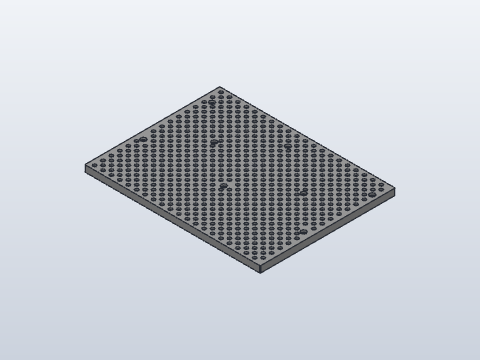 | Haas_DM-DT-1_26x20 | 660 x 508 x 24 | https://saundersmachineworks.com/products/haas-dm-dt-1-tooling-plate |
| 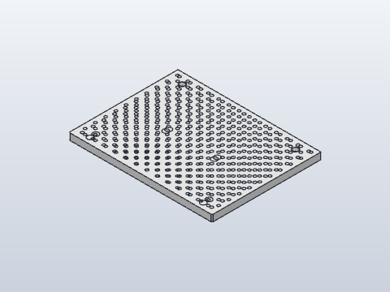 | Haas_Desktop-Mill_10.4x8 | 265 x 202 x 12 | https://saundersmachineworks.com/products/haas-desktop-mill-fixture-tooling-plate |
| 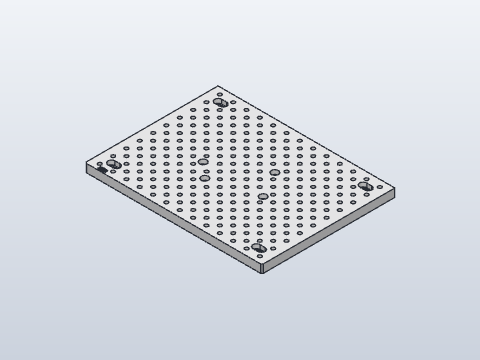 | Haas_Desktop_Mill_M6 | 265 x 199 x 12 | https://saundersmachineworks.com/products/haas-desktop-mill-fixture-tooling-plate |
|  | Haas_Desktop_Plate_Inch | 265 x 199 x 12 | https://saundersmachineworks.com/products/haas-desktop-mill-fixture-tooling-plate |
|  | Haas_Mini-Mill-2_40x16 | 1016 x 406 x 20 | https://saundersmachineworks.com/products/haas-mini-mill-2-steel-fixture-tooling-plate |
|  | Haas_Mini-Mill_40x16 | 1016 x 406 x 20 | https://saundersmachineworks.com/products/haas-mini-mill-fixture-tooling-plate |
|  | Haas_Pocket_Mill_Fixture_Plate | 889 x 406 x 24 | https://saundersmachineworks.com/products/haas-pocket-mill-fixture-tooling-plate |
|  | Haas_TM-0_40x16 | 1016 x 406 x 24 | https://saundersmachineworks.com/products/haas-tm-0-fixture-tooling-plate |
| 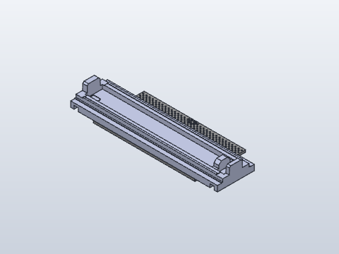 | Haas_TM-3_40x20 | 1467 x 508 x 182 | https://saundersmachineworks.com/products/haas-tm-3-fixture-tooling-plate |
| 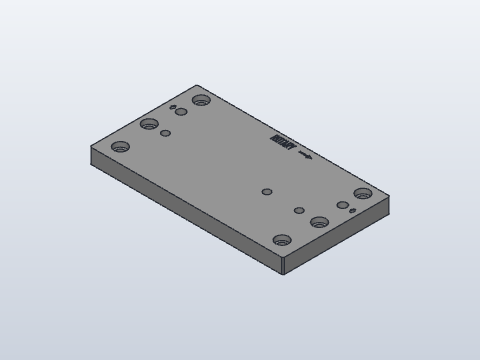 | Haas_Tailstock_Subplate | 304 x 168 x 23 | https://saundersmachineworks.com/products/haas-subplate |
| 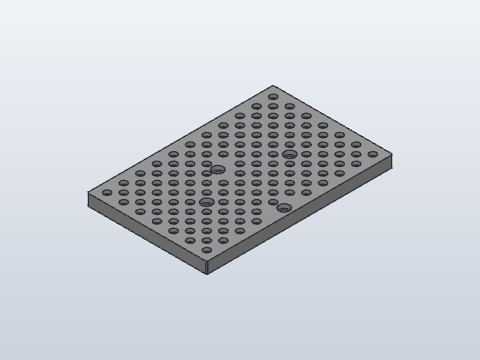 | Haas_UMC-500_14x9 | 356 x 229 x 22 | https://saundersmachineworks.com/products/haas-umc-500-b90-fixture-tooling-plate |
| 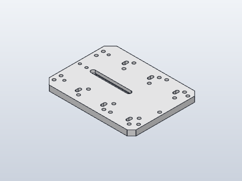 | Haas_Universal-Subplate | 400 x 305 x 24 | https://saundersmachineworks.com/products/haas-subplate |
| 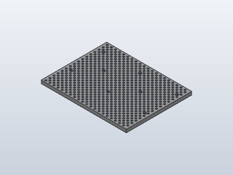 | Haas_VF-1_26x20 | 660 x 508 x 24 | https://saundersmachineworks.com/products/haas-vf-1-fixture-tooling-plate |
|  | Haas_VF-2YT_Fixture_Plate_Solid_Model | 1016 x 508 x 24 | https://saundersmachineworks.com/products/haas-vf-2yt-steel-fixture-tooling-plate |
| 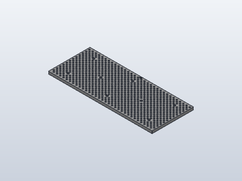 | Haas_VF-2_40x16 | 1016 x 406 x 24 | https://saundersmachineworks.com/products/haas-vf2-steel-fixture-tooling-plate |
|  | Haas_VF-3YT_VF-5_Rev4 | 1416 x 610 x 24 | https://saundersmachineworks.com/products/haas-vf-5-fixture-tooling-plate-1 |
|  | Haas_VF-3_Fixture_Plate | 1016 x 506 x 24 | https://saundersmachineworks.com/products/haas-vf3-fixture-tooling-plate |
|  | Haas_VF-4_Rev3 | 1416 x 610 x 24 | https://saundersmachineworks.com/products/haas-vf4-steel-fixture-tooling-plate |
| 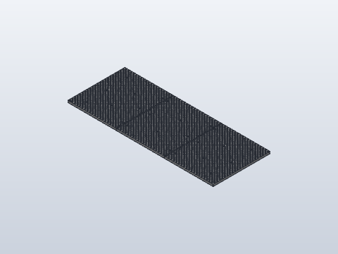 | Haas_VF-6_Rev4 | 1816 x 711 x 24 | https://saundersmachineworks.com/products/haas-vf-6-fixture-tooling-plate-set |
| 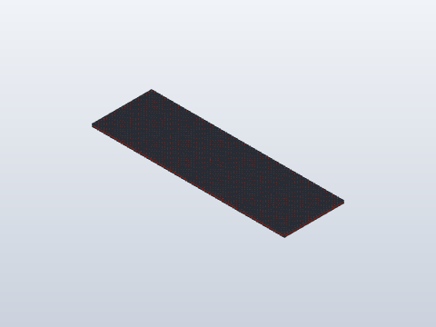 | Haas_VF-7_Fixture_Plate_Set | 2302 x 711 x 24 | https://saundersmachineworks.com/products/haas-vf-7-fixture-tooling-plate-set |
| 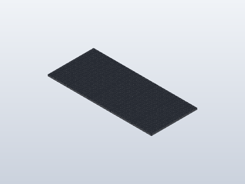 | Haas_VF-9_Fixture_Plate_Set | 2305 x 1016 x 24 | https://saundersmachineworks.com/products/haas-vf-9-fixture-tooling-plate-set |
| 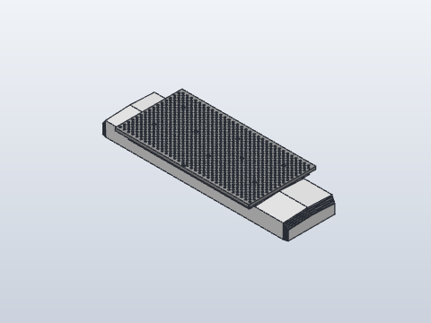 | Haas_VM-2_40x20 | 1407 x 508 x 192 | https://saundersmachineworks.com/products/haas-vm2-steel-fixture-tooling-plate |
|  | Haas_VM-3_Rev3 | 1416 x 610 x 24 | https://saundersmachineworks.com/products/haas-vm-3-steel-fixture-tooling-plate |
| 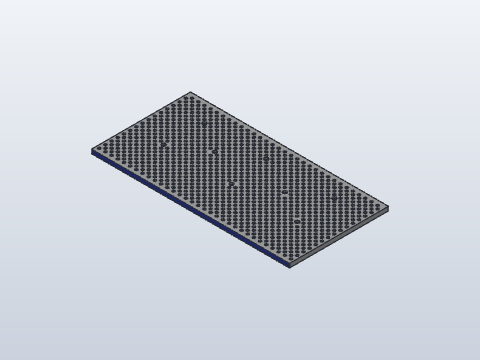 | Hurco_VM10i_40x20 | 1016 x 508 x 20 | https://saundersmachineworks.com/products/hurco-vm10i-xl-fixture-tooling-plate-old-stock |
|  | Hurco_VM10i_Fixture_Plate | 889 x 406 x 24 | https://saundersmachineworks.com/products/hurco-vm10i-fixture-tooling-plate |
| 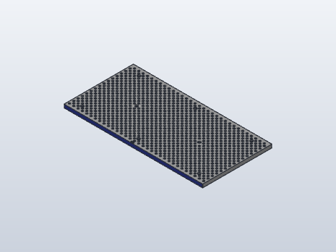 | Hurco_VM20i_Rev2 | 1016 x 508 x 24 | https://saundersmachineworks.com/products/hurco-vm20i-fixture-tooling-plate |
| 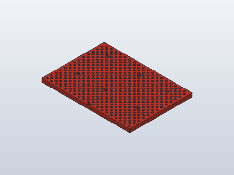 | Hurco_VM5i_Rev2 | 610 x 432 x 24 | https://saundersmachineworks.com/products/hurco-vm5i-fixture-tooling-plate |
|  | Hurco_VMX24i_Fixture_Plate | 889 x 508 x 24 | https://saundersmachineworks.com/products/hurco-vmx24i-fixture-tooling-plate |
|  | Hurco_VMX42i_Fixture_Plate_Set | 1416 x 610 x 24 | https://saundersmachineworks.com/products/hurco-vmx42i-fixture-tooling-plate-set |
| 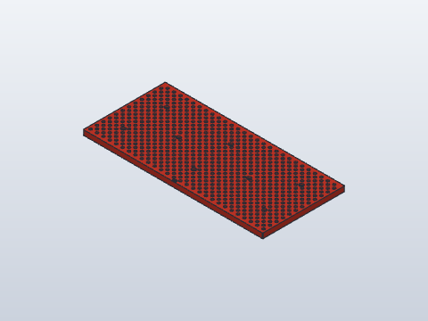 | Hurco_VM_One_Solid_Model | 889 x 406 x 24 | https://saundersmachineworks.com/products/hurco-vm-one-fixture-tooling-plate |
| 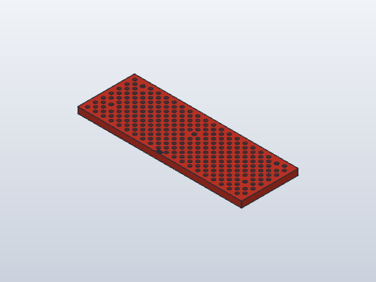 | Import_Milling_Machine_26x9 | 660 x 229 x 24 | https://saundersmachineworks.com/products/import-milling-machine-aluminum-fixture-tooling-plate |
| 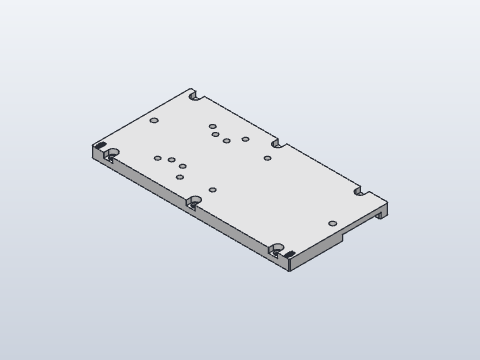 | Kurt_6in_Vise_Subplate | 457 x 229 x 24 | https://saundersmachineworks.com/products/kurt-vise-subplate-6-vises |
| 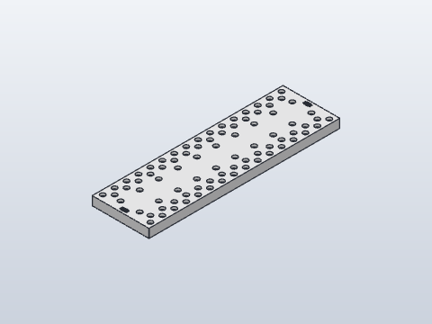 | Langmuir_MR-1_20x6 | 508 x 151 x 23 | https://saundersmachineworks.com/products/langmuir-mr-1-modular-vise-pallet-kit |
| 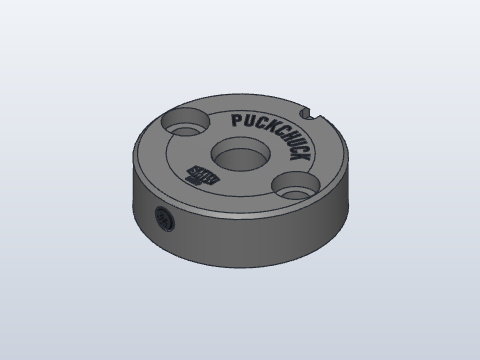 | Lite_Puck | 89 x 88 x 26 | https://saundersmachineworks.com/products/puckchuck-lite-puck |
| 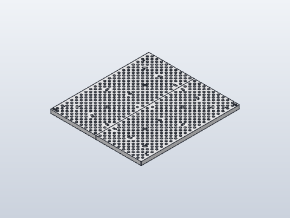 | MR-1_Fixture_Plate_Set | 660 x 610 x 23 | https://saundersmachineworks.com/products/langmuir-mr-1-fixture-tooling-plate-set |
| 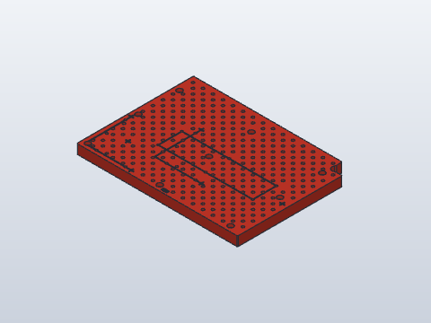 | Makera_Carvera_Air_Fixture_Plate_INCH | 306 x 222 x 18 | https://saundersmachineworks.com/products/makera-carvera-air-fixture-tooling-plate |
|  | Makera_Carvera_Air_Fixture_Plate_MM | 306 x 222 x 18 | https://saundersmachineworks.com/products/makera-carvera-air-fixture-tooling-plate |
|  | Makera_Carvera_Fixture_Plate | 357 x 240 x 18 | https://saundersmachineworks.com/products/makera-carvera-fixture-tooling-plate |
|  | Makera_Z1_Fixture_Plate_Solid_Model | 223 x 202 x 12 | https://saundersmachineworks.com/products/makera-z1-fixture-tooling-plate |
|  | Milltronics_TRM3016_Fixture_Plate | 1016 x 406 x 24 | https://saundersmachineworks.com/products/milltronics-trm3016-fixture-tooling-plate |
|  | Milltronics_VM3018_Fixture_Plate | 1016 x 508 x 24 | https://saundersmachineworks.com/products/milltronics-vm3018-fixture-tooling-plate |
|  | Okuma_M460-VE_Fixture_Plate | 1016 x 508 x 24 | https://saundersmachineworks.com/products/okuma-m460-ve-fixture-tooling-plate |
|  | Okuma_M560-V_Rev3 | 1416 x 610 x 24 | https://saundersmachineworks.com/products/okuma-m560v-fixture-tooling-plate |
|  | Okuma_M660-V_Rev1 | 1502 x 660 x 24 | https://saundersmachineworks.com/products/okuma-m660-v-fixture-tooling-plate-set |
|  | Precision_Mathews_PM45_34x12 | 864 x 304 x 22 | https://saundersmachineworks.com/products/precision-mathews-pm-45-fixture-tooling-plate |
|  | Precision_Matthews_PM-728VT_26x9 | 711 x 229 x 75 | https://saundersmachineworks.com/products/precision-matthews-pm-728vt-aluminum-fixture-tooling-plate |
|  | Precision_Matthews_PM-833_34x12 | 864 x 304 x 24 | https://saundersmachineworks.com/products/precision-matthews-pm-833-fixture-tooling-plate |
|  | Precision_Matthews_PM30_34x12 | 864 x 305 x 24 | https://saundersmachineworks.com/products/precision-matthews-pm-30mv-fixture-tooling-plate |
|  | PuckChuck_Pullstud | 31 x 24 x 24 | https://saundersmachineworks.com/products/puckchuck-pullstud |
|  | S1112_Brother_Speedio_S1000_CAD_Master | 1016 x 508 x 24 | https://saundersmachineworks.com/products/brother-speedio-s1000x1-steel-fixture-tooling-plate |
|  | S1356_Shapeoko_4_INCH | 300 x 300 x 13 | https://saundersmachineworks.com/products/shapeoko-4-fixture-plate |
|  | S1366_Shapeoko_4_METRIC | 300 x 300 x 13 | https://saundersmachineworks.com/products/shapeoko-4-fixture-plate |
|  | S1757_Gen3_Soft_Jaw | 96 x 59 x 14 | https://saundersmachineworks.com/products/mod-vise-soft-jaws |
|  | S1822_Gen3_Smooth_Insert_Bar | 96 x 15 x 13 | https://saundersmachineworks.com/products/smooth-jaw-insert-for-modular-vise |
|  | S1933_Round_Pin | 24 x 13 x 13 | https://saundersmachineworks.com/products/smw-1-2-fixturing-pin |
|  | S1934_Diamond_Pin | 24 x 13 x 13 | https://saundersmachineworks.com/products/smw-1-2-fixturing-pin |
|  | S1955_Mechanical_PuckChuck | 126 x 126 x 49 | https://saundersmachineworks.com/products/mechanical-puckchuck-receiver-gen2 |
|  | S1956_Mechanical_PuckChuck | 140 x 140 x 49 | https://saundersmachineworks.com/products/mechanical-puckchuck-receiver-gen2 |
|  | S1957_Automatic_PuckChuck | 126 x 126 x 49 | https://saundersmachineworks.com/products/automatic-puckchuck-zero-point-receiver-gen2 |
|  | S1958_Automatic_PuckChuck | 140 x 140 x 49 | https://saundersmachineworks.com/products/automatic-puckchuck-zero-point-receiver-gen2 |
|  | S2029_Round_Pin | 24 x 12 x 12 | https://saundersmachineworks.com/products/smw-12mm-fixturing-pin |
|  | S2030_Diamond_Pin | 24 x 12 x 12 | https://saundersmachineworks.com/products/smw-12mm-fixturing-pin |
|  | S2126_S2127_Haas_DC-1_Fixture_Plate | 889 x 508 x 24 | https://saundersmachineworks.com/products/haas-dc-1-fixture-tooling-plate |
|  | SMW_Bank-Pallet_12x8 | 304 x 202 x 30 | https://saundersmachineworks.com/products/smw-blank-pallet-12-x-8 |
|  | SMW_Fixture-Pallet_12x8 | 304 x 202 x 30 | https://saundersmachineworks.com/products/smw-fixture-pallet |
|  | SMW_RapidTurn_Subplate | 260 x 189 x 15 | https://saundersmachineworks.com/products/tormach-rapidturn-subplate-sale |
|  | SYIL_V5_18x9 | 457 x 229 x 22 | https://saundersmachineworks.com/products/syil-v5-fixture-tooling-plate |
|  | SYIL_X5_Fixture_Tooling_Plate | 610 x 305 x 24 | https://saundersmachineworks.com/products/syil-x5-fixture-tooling-plate |
|  | SYIL_X7_34x12 | 864 x 304 x 24 | https://saundersmachineworks.com/products/syil-x7-fixture-tooling-plate |
|  | SYIL_X9_Fixture_Plate | 1016 x 508 x 24 | https://saundersmachineworks.com/products/syil-x9-fixture-tooling-plate |
|  | Samurai_120i_CAD_Master | 500 x 244 x 22 | https://saundersmachineworks.com/products/samurai-machine-tools-120i-fixture-tooling-plate |
|  | Shapeoko_5 | 615 x 304 x 23 | https://saundersmachineworks.com/products/shapeoko-5-pro-fixture-tooling-plate |
|  | Shariff_DMC2_Rev3 | 356 x 253 x 15 | https://saundersmachineworks.com/products/shariff-dmc2-fixture-tooling-plate |
|  | Smart_SM1050 | 1016 x 508 x 24 | https://saundersmachineworks.com/products/smart-sm1050-fixture-tooling-plate |
|  | TM-1_TM-2_CAD_Master_Rev2 | 1016 x 406 x 22 | https://saundersmachineworks.com/products/haas-tm-1-2-fixture-tooling-plate |
|  | TRAK_Universal_Plate | 864 x 304 x 24 | https://saundersmachineworks.com/products/southwest-industries-trak-fixture-tooling-plate |
|  | TRAK_VMC2_Fixture_Plate | 475 x 400 x 24 | https://saundersmachineworks.com/products/trak-vmc2-2op-fixture-tooling-plate |
|  | Tormach_1100_12x34Alu | 864 x 304 x 24 | https://saundersmachineworks.com/products/tormach_1100_aluminum_fixture_plate |
|  | Tormach_1100_40x16 | 1013 x 406 x 24 | https://saundersmachineworks.com/products/tormach-1100-steel-fixture-plate |
|  | Tormach_1500MX_Rev2 | 889 x 406 x 24 | https://saundersmachineworks.com/products/tormach-1500mx-fixture-tooling-plate |
|  | Tormach_24R_Fixture_Plate_Set_Rev2 | 1308 x 660 x 23 | https://saundersmachineworks.com/products/tormach-24r-fixture-tooling-plates |
|  | Tormach_440_9x18 | 457 x 227 x 24 | https://saundersmachineworks.com/products/tormach-440-fixture-plate |
|  | Tormach_770_26x12 | 660 x 304 x 24 | https://saundersmachineworks.com/products/tormach-770-fixture-plate |
|  | Tormach_770_34x12 | 864 x 305 x 22 | https://saundersmachineworks.com/products/tormach-770-xl-fixture-tooling-plate |
|  | Tormach_microARC_6_Subplate | 286 x 253 x 24 | https://saundersmachineworks.com/products/tormach-microarc-6-4th-axis-subplate |
|  | Tormach_xsTECH_12x6 | 305 x 151 x 15 | https://saundersmachineworks.com/products/tormach-xstech-aluminum-fixture-tooling-plate |
|  | Universal_Knee_Mill_Set_CAD_Master | 1295 x 304 x 24 | https://saundersmachineworks.com/products/universal-knee-mill-bridgeport-trak-prototrak-jet-fixture-tooling-plate-set |
|  | Universal_Plates | 507 x 300 x 15 | https://saundersmachineworks.com/products/millenium-machines-milo-v1-5-aluminum-fixture-tooling-plate |
|  | VF-8_Fixture_Plate_Set | 1829 x 1016 x 24 | https://saundersmachineworks.com/products/haas-vf-8-fixture-tooling-plate-set |
|  | VORON_Cascade_INCH | 340 x 225 x 15 | https://saundersmachineworks.com/products/voron-cascade-fixture-tooling-plate |
|  | VORON_Cascade_MM | 340 x 225 x 15 | https://saundersmachineworks.com/products/voron-cascade-fixture-tooling-plate |
|  | microARC4_Rev3 | 219 x 125 x 15 | https://saundersmachineworks.com/products/tormach-microarc-4th-axis-subplate |
